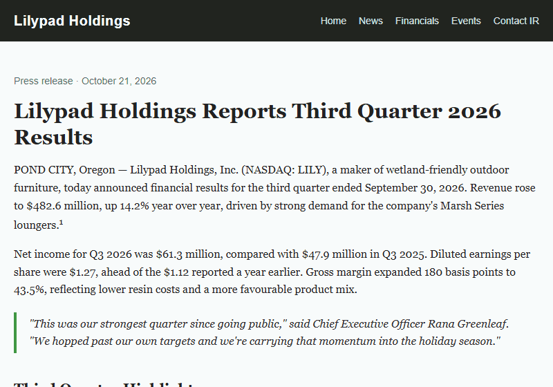
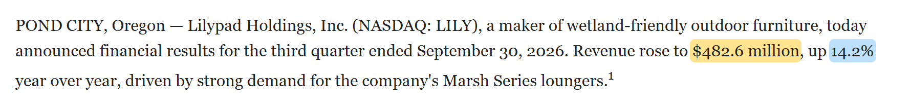
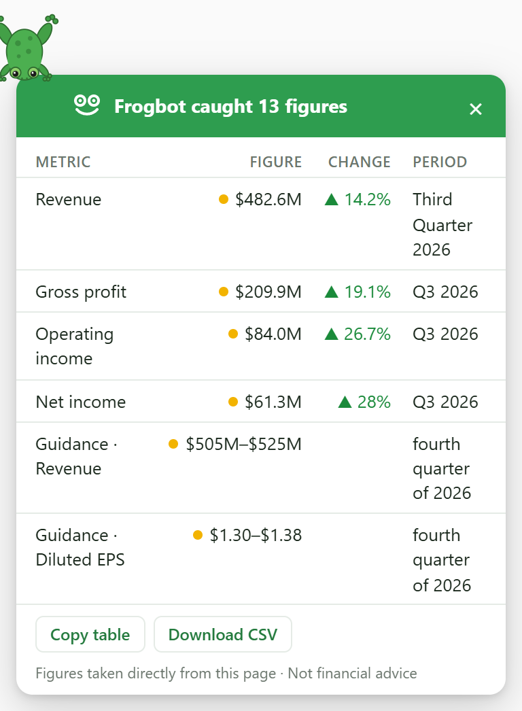
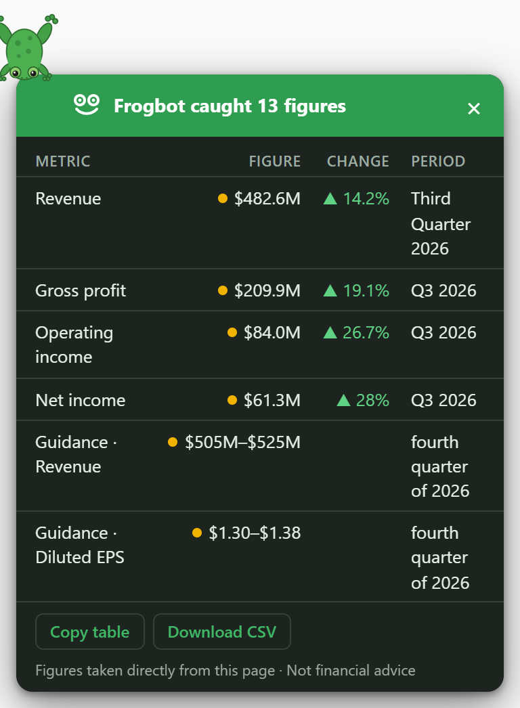

# Frogbot

A frog that hops through financial articles and catches the numbers that matter.



## What it does

- **Finds the key figures** in a finance article or earnings release (revenue, profit, EPS,
  margins, guidance) by scoring every sentence and table row on the page.
- **Highlights each figure exactly where it appears**, colour-coded by type, as the frog hops
  down the page and flicks its tongue at it.
- **Delivers a summary card** with the figures it caught, their periods and change arrows
  (green when the move is good for that metric, red when it's bad).
- **Jumps back to the source**: click any row on the card to scroll to that figure on the page.
  Copy the table into a spreadsheet, or download it as CSV.



| The card in light mode | The card in dark mode |
| --- | --- |
|  |  |

## Why not just paste the article into an AI chat?

Every figure on the card comes straight from the page, and you can see exactly where: each
one is highlighted in the article, and clicking its row takes you back to it. Nothing is
generated or paraphrased, so nothing can be made up; figures are shown as written or in a short
form ("$482.6 million" as "$482.6M"), and the CSV export keeps the source sentence. When Frogbot
isn't sure what a figure is (its label, its period, or which way it moved), it says so rather
than guessing: an unclear label goes under "Also caught", an inferred period is shown in
lighter italics, and an unclear direction gets no arrow.

## Privacy

Frogbot runs entirely in your browser, and only on the tab where you click it. It has no
background script, makes no network requests, and sends no data anywhere. Downloaded CSV files
are saved straight to your computer.

It asks for three permissions:

| Permission | Why |
| --- | --- |
| `activeTab` | Access to the current tab only, and only after you click the extension. |
| `scripting` | To add the frog, the highlights and the card to that tab. |
| `storage` | To remember one setting locally: whether the debug view is on. |

## Install

Frogbot isn't in an extension store yet; load it from this folder.

**Chrome**

1. Open `chrome://extensions`.
2. Turn on **Developer mode** (top right).
3. Click **Load unpacked** and select this `frogbot` folder.
4. Optional: pin Frogbot from the puzzle-piece menu so its icon is always visible.

**Edge**

1. Open `edge://extensions`.
2. Turn on **Developer mode** (in the left-hand panel).
3. Click **Load unpacked** and select this `frogbot` folder.
4. Optional: pin Frogbot from the extensions (puzzle-piece) menu.

Then open a finance article, click the Frogbot icon and press **Release the frog**. Press
**Escape**, or the card's **×**, to remove the frog, the card and every highlight; the page is
restored exactly as it was.

To try it on the included sample page, turn on **Allow access to file URLs** on Frogbot's
details page, then open `test-pages/earnings-sample.html` (a fictional company's earnings
release) in a tab.

## How it works

Everything runs in the page when you click the button, in six stages:

1. **Extract** (`content/extract.js`). Finds the article's main content and splits it into
   paragraph, list, table, heading and quote blocks, skipping navigation, captions, related
   links, collapsed and hidden content. Each sentence and each table row becomes a unit to score.
2. **Detect** (`content/score.js`). Finds every number in a unit and works out what it is:
   money, percentage, basis points, per-share amount, multiple, period, date, year or count,
   with its value, currency and scale. Junk such as phone numbers, addresses, footnote markers
   and copyright years is flagged and ignored.
3. **Score** (`content/score.js`). Gives each unit points for money and percentages, change
   words near a number, finance terms, periods and comparisons, and takes points off for
   junk-only units, very long ones and old figures.
4. **Pick** (`content/score.js`). Chooses about one target per 100 words of article (3 to 12),
   never the same figure twice and spread across topics, then orders them down the page so the
   frog only hops downward.
5. **Facts** (`content/facts.js`). Turns each caught figure into a record: a label ("Gross
   profit", "Non-GAAP diluted EPS", "Guidance: Revenue"), a period, whether it's a level, a
   change, guidance or an estimate, which way it moved, and how confident each of those is.
   Repeats of the same figure are merged.
6. **Card** (`content/card.js`). The frog hops to the corner and drops the card: one row per
   metric in order of importance, with the top 7 shown and the rest behind "Show all".
   Figures with a guessed label go under "Also caught". The card lives in a shadow root, so the
   site's styles can't change it.

### Colour key

| Colour | Meaning | Example |
| --- | --- | --- |
| Gold | Money and per-share figures | $482.6 million, $1.27 per share |
| Blue | Percentages and basis points | 14.2%, 180 bps |
| Purple | A period or date attached to a figure | the "Q3 2026" in "$12.4B in Q3 2026" |
| Grey | Multiples | 2.5x |

On the card, ▲ means up, ▼ down and ▬ flat; green is good for that metric (revenue up,
costs down), red is bad, and grey is neutral or unknown.

## Accuracy and testing

The number detection, scoring and fact-record code is plain JavaScript with no page access,
so it's tested on its own against hand-written cases:

| Suite | File | Cases |
| --- | --- | --- |
| Number detection and sentence splitting | `tests/detect-cases.js` | 212 |
| Scoring and target picking | `tests/score-cases.js` | 87 |
| Fact records (labels, periods, direction) | `tests/facts-cases.js` | 136 |
| Held-out set | `tests/holdout-cases.js` | none yet |

All development cases currently pass. `tools/snapshot_targets.py` also checks that the targets
and fact records picked on each test page only change when intended.

There are two kinds of test case, reported separately:

- **Development set**: the cases the code was built and fixed against. Every bug that turns up
  gets a case here, and the code is changed until it passes, so this set's accuracy is close to
  100% by construction. It shows that known problems stay fixed, not how well Frogbot does on
  pages it hasn't seen.
- **Held-out set**: cases written by hand from pages never used in development, and never used
  as a reason to change the code. Its accuracy is the honest estimate of how Frogbot does on a
  new article.

Held-out accuracy: to be measured.

## Known issues

- **Pages that scroll inside a box.** Some sites (currently BBC) scroll the article inside an
  inner container instead of scrolling the page itself, sometimes switching to that only after
  the frog appears. The frog is positioned on the page, so it may not scroll into view there,
  though it still lands next to its targets.
- **Start position on those pages.** The same layout switch occasionally moves BBC's first
  paragraph under the frog after it has appeared, so the frog can end up sitting on text.
- **Cookie banners.** A site's consent overlay can sit above the frog and the card, and take
  keyboard focus, until it's dismissed.

## Backlog

- Pages that scroll the article inside an inner container: position the frog inside that
  container, or follow its scrolling.
- An optional subtle tint on the chosen sentence, so a figure reads in context. Left out for now
  because it looked cluttered next to the coloured figure highlights.
- Re-map highlights when a page re-renders its content after the frog has run (marks placed
  before a re-render are lost, though Escape still cleans up, and the card outlines the
  figure's block instead).
- Detect numbers during extraction, so scoring doesn't compute them a second time. Scoring
  takes about 30ms on a big earnings release, which is acceptable for now. Timings vary with
  machine load (60-80ms is common on a busy machine), so they're logged for information rather
  than treated as a pass/fail test; only times above 150ms would point to a real problem.
- "to" and "from" are loose change words (they match "returned $24.3 billion to
  shareholders" as readily as "rose to $1.2 billion"). Consider counting them only in patterns
  like "from X to Y" or right after a change verb ("rose to", "fell from").
- Direction for words whose meaning depends on their subject: a loss that "narrowed" or
  "widened", a decline that "eased", growth that "slowed" or "accelerated". These give no
  direction for now.
- Direction for a change that shares an earlier change word: in "up 20% from the previous
  quarter and 73% year-over-year", the 73% has no direction of its own yet.
- Tighten the passive "is expected to" guidance rule to require a company subject. At the
  moment it can tag industry-wide forecasts as guidance (for example "the tech industry is
  expected to spend a combined $765bn").

## Roadmap

- **Milestone 1: the frog and its catches (done).** Hopping, the tongue, page extraction,
  number detection, scoring and target picking, and exact-number highlighting coloured by type.
- **Milestone 2: the summary card (done).** Fact records with labels, periods, change direction
  and confidence; the card the frog delivers, with change arrows, "Show all" and "Also caught";
  click a row to jump back to its figure; Copy table and Download CSV.
- **Milestone 3: AI summary (not started).** A short summary written only from the chosen
  sentences, with a check that every number in the summary appears on the page. On-device AI
  where the browser has it, and a rules-only fallback otherwise.

## Project structure

```
manifest.json        MV3 manifest (activeTab, scripting and storage only)
popup/               The toolbar popup with the "Release the frog" button
content/main.js      Entry point injected on click: extracts, picks targets, runs the hops
content/frog.js      window.Frogbot: the inline-SVG frog, hopping, tongue, show()/remove()
content/extract.js   window.FrogbotExtract: main-content detection, text blocks, scoring
                     units, and mapping text positions back to the page
content/score.js     window.FrogbotScore: sentence splitting, number detection, scoring
                     and target picking (pure functions, no page access)
content/highlight.js window.FrogbotHighlight: exact figure marks, pulses, whole-block fallback
content/facts.js     window.FrogbotFacts: one record per caught figure (label, period, role)
content/card.js      window.FrogbotCard: the summary card, rendered in a shadow root
content/frogbot.css  Frog and highlight styles (all classes prefixed frogbot-)
assets/              The frog artwork and the extension icons (with their SVG sources)
docs/                The demo GIF and screenshots used in this README
test-pages/          Local pages written for testing (no copied pages)
tests/               Test cases, the browser test runner, and snapshots of each test page's
                     targets and fact records
tools/               Developer scripts (not part of the extension)
```

### Running the tests

- **In the browser:** open `tests/run-tests.html` straight from the file system in Edge or
  Chrome. It shows a summary, accuracy for each number type, and a row per case; failed rows
  show what was expected and what was found. Reload after editing the code or cases. The page
  has four sections: detection, scoring, facts and the held-out set.
- **From the command line:** `python tools/run_tests.py` runs the same page in headless Edge or
  Chrome and prints the summary and any failures for each set (exit status 1 if anything
  fails). Set `FROGBOT_BROWSER` to a browser executable if it isn't found automatically.
- **Snapshots:** after changing scoring or facts, run `python tools/snapshot_targets.py`. It
  prints how the picks and their fact records changed on each test page compared with
  `tests/snapshots/`; run it with `--update` to save them once you're happy.

The tools need Python 3 and nothing else, apart from one optional script:
`tools/record_demo.py` re-records `docs/demo.gif` and the README screenshots from the test page,
and needs Selenium and Pillow (`pip install selenium pillow`). It's only needed to update the
GIF.

To add a detection case, copy one in `tests/detect-cases.js`: give the text, where it came
from, and the numbers you expect. Only the fields you list are checked, but every number found
must be expected.

To add held-out cases:

1. Pick a page that hasn't been used for development (not the test pages, the Wikipedia
   Nvidia article, the BBC data centre article, or the Nvidia and Apple releases used so far).
2. Copy sentences or table cells into `tests/holdout-cases.js` in the same format as the
   development cases, with the page's URL as `source`, and write down the numbers you expect
   *before* running the tests.
3. Run the tests and record the held-out accuracy. If a case fails, don't change the code to
   fix that case. Write a new development case that shows the same problem, fix against that,
   and leave the held-out case untouched. Add fresh held-out cases from another new page from
   time to time, since the old ones slowly stop being "unseen".

The three entries already in `holdout-cases.js` are format examples marked `example: true`;
the runner skips them, so it reports "No held-out cases yet" until real ones are added.

### Test pages

- `test-pages/earnings-sample.html`: a fictional earnings release for "Lilypad Holdings", with
  real-looking figures plus junk numbers (phone numbers, a street address, a page number,
  footnote markers, a copyright year) for the scorer to ignore. Add `?frogbot-fixed` to its URL
  to make the frog hop to four hand-placed targets instead of scored ones (useful for checking
  the animation).
- `test-pages/mapping.html`: tricky markup for exact highlighting: figures split across `<b>`,
  `<a>` and `<span>`, `&nbsp;`, Wikipedia-style `[1]` markers, line breaks and table cells. Each
  case lists what should be highlighted in `data-expect-figures`.
- `test-pages/captions-and-collapsed.html`: a news-style article for checking what extraction
  skips: photo captions and credits, a key-points box, a collapsed AI summary, a closed
  `<details>` and a squashed hidden box, each marked `data-expect="keep"` or `"skip"`.

### Debug view

Tick **Show what Frogbot reads** in the popup before releasing the frog (the setting is
remembered). Frogbot then outlines everything it extracted: the main content container in solid
red, and every block in a dashed outline coloured by type (paragraph grey, list green, table
blue, heading purple, quote orange) with an `index type · score` label; chosen targets get a
solid outline. The page's DevTools console gets tables of the blocks, the numbers found by type
(and how many were junk), every scored sentence and table row with its reasons, and the fact
records, with timings for extraction, detection and scoring. Escape clears the outlines with
the frog.

### How targets are scored

`score.js` scores every unit with `scoreUnit()` and picks targets with `pickTargets()`:

- Points for money, percentages and per-share figures, a change word near a number, finance
  terms, periods, comparisons and context (bold text, a heading with a number, or a table row
  without column headers; rows with headers get the period point from them instead), and
  penalties for units with only counts or years, only junk, or over 60 words, and for old
  figures: a unit whose newest explicit year is 5-9 years older than the newest year on the
  page loses 2, and 10 or more years older loses 4 (not when it names a current period such
  as "Q3", or has no year). Every weight, and the topic list below, is in the `WEIGHTS` object
  at the top of `score.js`.
- Units below `MIN_SCORE` are dropped. Ties go to prose sentences over table rows, then to
  units with more distinct positive signals, then to page order.
- While picking, a unit whose main figure was already picked loses points and has to compete
  again. For variety, a unit also loses 2 for each chosen unit already on its topic (-2, -4,
  -6...). Topics are revenue, gross profit, operating income, net income, EPS, margin,
  guidance, cash flow, debt, dividends/buybacks, growth/estimates and other. A sentence is
  guidance only when it's the company's own forward-looking statement ("Lilypad expects",
  "full-year guidance", "next quarter", or "revenue is expected to"); analysts' expectations
  are growth/estimates. The first table row on a named topic is exempt, so a headline row like
  an infobox "Revenue" isn't crowded out by sentences. The topic penalty only reorders the
  queue; it never drops a unit below `MIN_SCORE`.
- About one target per 100 words of article (3 to 12, and at least 5 when 5 or more units pass
  the threshold), at most 2 from one block and 4 rows from one table, then sorted into page
  order.

### Fact records

`FrogbotFacts.buildFacts(targets, blocks)` turns every caught figure into a record. Each has
the figure (`value`, or `low`/`high` for a range, `type`, `currency`, `scale`, and a short
`display` like "$482.6M" or "$505M–$525M"), plus:

- **label**: the table row header, or the nearest finance term before the figure in the same
  clause ("Revenue", "Operating income", "Diluted EPS"...), with qualifiers attached: GAAP /
  non-GAAP, adjusted, diluted, organic, a segment name ("Gaming revenue"), or a table title.
  Guidance figures get "Guidance: <metric>". A percentage that's a share of a group ("83% of
  S&P 500 companies", "24% having released results") takes no metric label. When no term is
  found, the label is a short snippet of the text around the figure.
- **role**: `level`, `change` (rose 14.2%, +19.1%, year-over-year), `guidance` or `estimate`
  (analyst or consensus figures). A change is linked to the level with the same label in the
  same clause or row (`change` on the level, `linkedTo` on the change); a level shows a
  percentage change over an amount.
- **period** and **periodSource**: the period in the same clause (`clause`), then elsewhere in
  the sentence (`sentence`), then the table column header (`table`), then the line that
  introduces a list (`listIntro`), then the nearest heading (`heading`, including bold-paragraph
  headings, and the page's title until the first heading), then the page's most common period
  (`page`), or none. Guidance never takes the page's period, since that is usually the quarter
  just reported. A table's change column never takes a heading or page period.
- **labelConfidence**: `high` for a table row header, or a finance term in the figure's own
  clause; `medium` for a label with qualifiers or a segment, a term borrowed from an earlier
  clause, or a guidance label; `low` for a snippet.
- **periodConfidence**: `high` for `clause`; `medium` for `sentence`, `table`, `listIntro` and
  `heading`; `low` for `page`; null when there is no period. `periodInferred` is true when it's
  `low`. **confidence** is the lower of the two (a missing period doesn't lower it).
- **showOnCard**: true when the label is `high` or `medium` and the fact is a level, guidance,
  or a change with no level to link to, and it isn't an earlier table column.
- **priorPeriod** and **prior**: in a row with comparable period columns ("Q3 2026" and
  "Q3 2025"), the earlier columns are `priorPeriod` (off the card), and the current figure's
  `prior` is the one it's compared with (the same period a year earlier, else the latest
  before it).
- **sources**: every place the figure was caught. The same figure with the same label, period
  and qualifiers is merged into one record (money within 0.5%, percentages exactly), keeping the
  most confident copy. Different qualifiers (GAAP vs non-GAAP) are never merged.
- **direction** (`up`, `down`, `flat` or null) and **directionSource**. If the page doesn't
  make the direction plain, it is null. In order:
  - `changeColumn`: a signed or bracketed value in a table change column ("+8%", "(3)%",
    "-3%", "0%"). An unsigned value ("56%" under "Y/Y") counts as up only when the page writes
    its falls with brackets or minus signs in its tables, and the period columns the change
    compares agree.
  - `sign`: a signed change figure in prose ("+12.5%").
  - `verb`: a change word near the figure in its clause ("rose", "fell", "up", "lower",
    "unchanged", "a record $4.3 billion"). A negation within three words ("did not rise",
    "failed to grow") or a word whose meaning depends on its subject ("the loss narrowed",
    "growth slowed") gives null.
  - `fromTo`: "from $X to $Y", "$Y, from $X", or "$Y, up from $X" when the values agree with
    the words.
  - `tableColumns`: a row with current and prior period columns whose headers match apart from
    their dates. Direction only; no percentage is computed.

  A linked change passes its direction to its level (if they disagree, the level gets none).
- **sentiment** (`good`, `bad`, `neutral` or null), for canonical metrics only. Up is good for
  revenue, profits, EPS, margins, cash flow, cash, dividends and buybacks; up is bad for
  operating expenses, debt and losses; capital expenditure is neutral; flat is neutral.
- **vsEstimate** (`above`, `below` or null): "beat", "above consensus", "missed", "below
  estimates" said about the figure itself. It sets the sentiment when present.
- **tolerance**: "plus or minus 2%", "±2%" or "plus or minus 50 basis points" on a guidance
  figure is added to its display ("$54.0B ±2%") instead of becoming its own fact.

Money displays keep the page's decimal places when the unit matches ("$54.0 billion" shows as
"$54.0B").

### The card in detail

- **Rows**: one main row per metric (label with its qualifiers, plus role). A metric's main row
  is its most recent period, then the higher label and period confidence, then the higher
  score; its other rows only appear under "Show all". Metrics go by importance: revenue, gross
  profit, operating income, net income, EPS, margins and cash flow, then guidance, then segment
  figures, then everything else; within that, levels come before standalone changes.
- **Columns**: Metric, Figure (with a dot in its highlight colour), Change (arrow plus the
  linked change; a tooltip gives the earlier column it's compared with, "vs $176.2M in
  Q3 2025") and Period (lighter and italic, with a tooltip, when inferred from the page).
- **Also caught (N)**: the other facts, apart from changes shown beside their level and earlier
  table columns. With no headline figures the card says "No headline figures here"; with no
  facts at all there is no card.
- **Jumping back**: every row is a button (click, Enter or Space). The page scrolls the figure
  to the middle of the window and pulses it, and the frog turns to look. A fact caught in
  several places cycles through them, with a "1/2" badge. If the highlight has gone because the
  page re-rendered, the block it came from is outlined instead. With reduced motion, the jump is
  instant and the figure gets a static outline.
- **Copy table** copies the main table and its "Show all" rows as tab-separated text (Metric,
  Figure, Change, Direction, Period), falling back to `execCommand("copy")` where the clipboard
  API is refused.
- **Download CSV** saves `frogbot-<site>-<yyyy-mm-dd>.csv` with every row: section, metric,
  figure, value, low, high, currency, type, role, change, direction, sentiment, period,
  period_inferred, prior, source_text, page_url and captured_at. It starts with a UTF-8 BOM so
  Excel shows £, € and – correctly.
- The card is a `role="dialog"`, follows the browser's dark mode, and becomes a full-width
  bottom sheet in windows narrower than 480px. It lives in a shadow root on a zero-size host
  element with inline `!important` styles, so only the card takes clicks and the site's CSS
  can't change it. Releasing the frog again after a run replaces the card; releasing it mid-run
  does nothing.

### Editing the frog artwork and icons

`assets/frog.svg` is the source of truth for the frog. `content/frog.js` holds a copy of it
between the `// FROG_SVG_START` and `// FROG_SVG_END` comments, so the legs can be animated with
CSS. After editing the SVG, run `python tools/sync_frog_svg.py` and reload Frogbot in the
extensions page. Keep the leg groups' `frogbot-leg-*` classes, since the hop animation styles
them.

The extension icons come from `assets/icon.svg` (32, 48 and 128px) and the simplified
`assets/icon-small.svg` (16px). After editing either, run `python tools/build_icons.py`, which
renders them with headless Edge or Chrome.

## License and author

MIT; see [LICENSE](LICENSE).

Built by Daniel ([github.com/DanGallagher06](https://github.com/DanGallagher06)).
